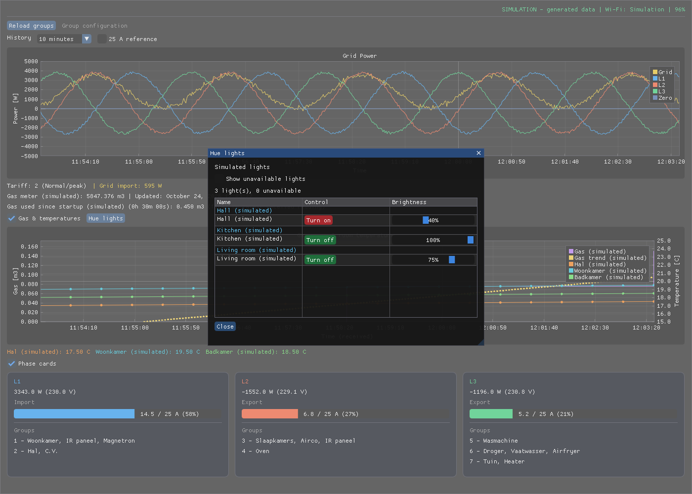

# P1Scope

Live P1 energy monitoring, phase by phase.

A Linux energy monitor for a HomeWizard P1 meter, with a C++20 desktop dashboard using Dear ImGui and ImPlot and a headless web dashboard for a server or Raspberry Pi. It discovers the meter using Avahi, reads its local HTTP API, and plots total grid power and power per phase. An optional Philips Hue bridge interface reads room temperature sensors and displays their readings alongside gas usage in a combined plot.

A simulation mode lets you use the dashboard without a meter or network connection.



*Desktop dashboard with Hue lights grouped by room, green (on) and red (off) toggle buttons, brightness sliders, and the option to reveal unavailable lights. Temperature readings sit below the gas and temperature plot; the Hue lights button sits beside its visibility checkbox. All readings are simulated, with 30 minutes of generated history and a selected 10-minute view.*

## Features

- Headless LAN server: view the dashboard from Windows, Android, or any modern browser.
- Live grid import/export and the meter's active tariff.
- Separate power curves for Grid (yellow), L1 (blue), L2 (orange), and L3 (green).
- Optional phase cards showing power, voltage, and measured current relative to 25 A.
  Use **Phase cards** above the cards to show or hide them (shown by default).
  In both dashboards, the grid power plot expands into the space freed by hidden
  gas/temperature plots and phase cards.
- Selectable 1-, 5-, 10-, and 30-minute views plus a 1-hour view, with automatic Y-axis scaling.
- Crosshairs and a shared tooltip showing the nearest sample's time and all four power values.
- Optional gas usage plot in m³, with the total gas meter reading and its reported timestamp.
- Philips Hue room temperatures alongside gas usage, with a separate °C axis, matching readout colors, and hover details.
- Hue bridge pairing through `hue_temperatures.py --pair`, background polling every 30 seconds, and connection diagnostics on stderr.
- Optional dashed reference lines at ±5,750 W per phase.
- Meter Wi-Fi name, signal strength, and connection status.
- Stale-data indication and gaps for failed requests or measurement intervals longer than three seconds.
- Timestamped stderr messages, bounded HTTP requests, and retries during outages.
- Responsive layout: phase cards stack vertically in narrow windows.

## Requirements

### Software

The requirements below include the desktop UI. For a headless server build, use
the smaller dependency list in [Run on a network server](#run-on-a-network-server).


- Linux with an X11 display, or XWayland in a Wayland session. The application explicitly selects GLFW's X11 backend.
- A C++20 compiler and standard library supporting `std::osyncstream`.
- CMake **4.3 or newer**, as specified in `CMakeLists.txt`.
- GLFW **3.4 or newer**, built with X11 support.
- OpenGL, libcurl, nlohmann/json, pkg-config, and Avahi client development libraries.
- Dear ImGui sources in `external/imgui` and ImPlot sources in `external/implot`.

For Debian/Ubuntu-based systems, the dependency package names are:

```bash
sudo apt install build-essential cmake pkg-config git \
    libcurl4-openssl-dev nlohmann-json3-dev libglfw3-dev \
    libgl1-mesa-dev libavahi-client-dev avahi-daemon avahi-utils
```

Check that your distribution provides sufficiently recent CMake and GLFW versions:

```bash
cmake --version
pkg-config --modversion glfw3
```

Use the project's existing ImGui/ImPlot checkouts where available. If these directories are missing, obtain the sources:

```bash
git clone https://github.com/ocornut/imgui.git external/imgui
git clone https://github.com/epezent/implot.git external/implot
```

The code uses ImPlot's `ImPlotSpec` API; older ImPlot versions may not compile. The external dependencies are compiled into the application by CMake.

### Meter connection

For live mode, the computer must be able to discover the meter through local mDNS and reach its local HTTP API. Avahi must be running, and local API access must be available on the meter.

Discovery searches for `_hwenergy._tcp` using IPv4. The application uses the advertised address and port to request:

```text
http://<address>:<port>/api/v1/data
```

The current implementation expects a three-phase report containing numeric values for:

- `active_power_w`
- `active_power_l1_w`, `active_power_l2_w`, `active_power_l3_w`
- `active_voltage_l1_v`, `active_voltage_l2_v`, `active_voltage_l3_v`

Phase currents (`active_current_l1_a`, etc.), `active_tariff`, `wifi_ssid`, and `wifi_strength` are optional. Missing optional readings are displayed as unavailable. Reports missing required readings are rejected.

## Build

From the project directory:

```bash
cmake -S . -B build -DCMAKE_BUILD_TYPE=Release
cmake --build build --parallel
```

The default build produces `build/p1scope` (desktop) and `build/p1scope-server` (headless web server).

In CLion, open the project as a CMake project, select a compatible toolchain, and build the `p1scope` target. Enter command-line options in the run configuration's program arguments.

## Run

Connect to the real meter:

```bash
./build/p1scope
```

The desktop window opens at 1400 × 1000 pixels so the plots, temperature readings,
and phase cards fit together. The window remains resizable. Connection and Wi-Fi status share the top-right
header line; tariff and grid import/export share a line, with tariff first, directly
above the gas readouts.

Run with simulated data:

```bash
./build/p1scope --simulation
```

Print the simulated JSON reports as well:

```bash
./build/p1scope -s -v
```

| Option | Short form | Description |
| --- | --- | --- |
| `--simulation` / `--simulated` | `-s` | Generate local P1 reports without Avahi discovery or HTTP requests. |
| `--report` | `-v` | Print each successful live or simulated JSON report to stdout. |
| `--config PATH` | | Load group assignments from another JSON file. |
| `--server` | | Run the desktop executable as a headless HTTP server instead of opening a window. The `p1scope-server` executable always uses server mode. |
| `--bind ADDRESS` | | IPv4 address to listen on in server mode; default `127.0.0.1`. Use `0.0.0.0` for LAN access. |
| `--port PORT` | | HTTP port in server mode; default `8080`. |
| `--web-root PATH` | | Directory containing `index.html`, `dashboard.js`, `dashboard.css`, and `vendor/`; defaults to the project's `web/` directory. |
| `--help` | `-h` | Show usage and examples. |

Options can be combined in any order. Use separate short options (`-s -v`); combined forms such as `-sv` are not supported.

`--report` clears and redraws the terminal for each report. It is a live console view, not a JSON-lines export. To save timestamped diagnostics separately:

```bash
./build/p1scope 2>p1-errors.log
```

Rebuild after modifying the source; changes to help text and behavior do not appear in an older executable.

## Run on a network server

The `p1scope-server` target runs without X11, Wayland, GLFW, OpenGL, or the
ImGui/ImPlot checkouts. It collects readings centrally and serves the dashboard
and a JSON API over HTTP. Windows and Android devices only need a browser; the
server itself currently runs on Linux, including Raspberry Pi OS.

### Build on the server

Copy the project to the server first, then build there so the executable matches
its CPU architecture. For example, use `/opt/p1scope` if installing the systemd
service below. Install the headless dependencies (Debian/Ubuntu package names):

```bash
sudo apt install build-essential cmake pkg-config \
    libcurl4-openssl-dev nlohmann-json3-dev libavahi-client-dev avahi-daemon
cmake -S . -B build-server -DP1SCOPE_BUILD_DESKTOP=OFF -DCMAKE_BUILD_TYPE=Release
cmake --build build-server --parallel 2
```

CMake 4.3 or newer is still required by this project's `CMakeLists.txt`; select a
compatible CMake installation if your distribution's package is older. No Node.js,
npm, Python, or internet connection is required to run the dashboard. D3 7.9.0 is
bundled in `web/vendor` with its license. Python is only needed for initial Hue
pairing and the optional integration check.

### Start and connect

Try simulation first:

```bash
./build-server/p1scope-server --simulation --bind 0.0.0.0 --port 8080
```

On another device on the same network, open `http://SERVER-IP:8080` (replace
`SERVER-IP` with the server's LAN IP address). For actual meter readings, omit
`--simulation`:

```bash
./build-server/p1scope-server --bind 0.0.0.0 --port 8080
```

On startup, the server prints timestamped **Web dashboard URL** messages to stderr.
When bound to `0.0.0.0`, these include localhost and each active LAN IPv4 address.
Use a LAN address when connecting from another device.

The default bind address is `127.0.0.1`, which only permits access from the server
itself. `--bind 0.0.0.0` enables access through all IPv4 interfaces. Allow TCP port
8080 through the server's firewall for your LAN if necessary. This HTTP dashboard
has no login and is intended for a trusted local network; do not port-forward it
to the internet.

The desktop executable also supports `./build/p1scope --server` with the same
options, but `p1scope-server` avoids desktop dependencies entirely. Stop the server
with Ctrl+C or SIGTERM. The desktop default remains a graphical application.

Keep `groups.json`, `.hue-credentials.json` (if using Hue), and `web/` available
at their source-directory locations. Edit groups on the server and click
**Reload groups** in the browser. The `--config /path/to/groups.json` option can
select another group file; `--web-root /path/to/web` can select another assets
directory. The HTTP server serves only its listed web assets and API routes,
never the source directory or credentials file.

For Hue, copy your existing `.hue-credentials.json` securely to the server's
project directory or run `python3 hue_temperatures.py --pair` there. The account
running the server must own and be able to read this file; keep its permissions
at `600`. Restart after changing Hue credentials. Without Hue, the gas and
electricity views continue to work; Hue diagnostics are logged to stderr.

The server needs local network discovery access to the P1 meter through Avahi,
and HTTPS access to the paired Hue bridge. Separate VLANs may require mDNS
forwarding. The existing three-phase meter requirement also applies to server mode.

The browser refreshes data every two seconds; P1 polling remains approximately
once per second and Hue polling every 30 seconds. One hour of history lives in
the server's memory, shared by all clients. Reloading a browser keeps that history;
restarting the server clears it and the gas-session baseline. Browser view options
are remembered locally. Connection failures are marked stale or unavailable.

### Run with Docker Compose (Linux)

The included `Dockerfile` builds the headless server; `compose.yaml` builds and
runs it with the web dashboard. Use Docker Engine and the Docker Compose plugin
on a Linux host (including a Raspberry Pi with 64-bit Linux). This setup uses
host networking and the host's Avahi service through its system D-Bus socket.
Docker Desktop on Windows/macOS is not supported by this configuration.

The Docker build happens on whichever host runs `docker compose up --build`.
For your **remote HP t620**, follow the remote deployment steps below; nothing
needs to run on your development machine after deployment.

#### Run from a Git checkout on the HP t620

Run the following steps **on the HP t620**, using its Linux installation on the
same LAN as the P1 meter and Hue bridge. Install Docker Engine and the Docker
Compose plugin, with Docker access for your user. Check with `docker version`
and `docker compose version`. Enable Avahi on the t620 host (Debian/Ubuntu):

```bash
sudo apt install avahi-daemon dbus git
sudo systemctl enable --now avahi-daemon
```

Check out the project there, or enter your existing checkout:

```bash
git clone https://github.com/pjd62/P1Scope.git
cd P1Scope
# Run once to match the container user to your local configuration-file owner:
printf 'P1SCOPE_UID=%s\nP1SCOPE_GID=%s\n' "$(id -u)" "$(id -g)" > .env
docker compose up -d --build
docker compose logs -f
```

Docker compiles the application and runs the headless web dashboard on the t620.
No C++ compiler or CMake needs installing on the host. The first build needs
internet access to download the base image, build tools, and packages. Open
`http://T620-IP:8080` from your laptop or phone; startup logs list usable URLs.
The container continues running after you disconnect SSH and restarts after the
t620 reboots, provided its Docker service starts at boot. `Ctrl+C` exits log-following
without stopping the detached container.

For Hue, `.hue-credentials.json` is deliberately not in Git. Copy your existing
paired file securely into the checkout, or pair directly on the t620:

```bash
sudo apt install python3
python3 hue_temperatures.py --pair
chmod 600 .hue-credentials.json
docker compose -f compose.yaml -f compose.hue.yaml up -d --build
```

Edit `groups.json` to match your wiring. For updates, run these commands in the
t620 checkout after preserving any local changes to tracked files:

```bash
git pull
docker compose up -d --build
```

Include `-f compose.yaml -f compose.hue.yaml` in Compose commands when using Hue.
Local `.env` settings and Hue credentials are ignored by Git. Run
`docker compose down` to stop the service. All build and run commands execute on
the t620; no Docker service is needed on your development machine.

#### Run directly on the current Linux host

From the project directory, ensure Avahi is running on the **host**:

```bash
sudo apt install avahi-daemon dbus
sudo systemctl enable --now avahi-daemon
# Match the container user to your local configuration-file owner:
export P1SCOPE_UID=$(id -u) P1SCOPE_GID=$(id -g)
docker compose up -d --build
docker compose logs -f
```

Open `http://SERVER-IP:8080`; startup logs list usable dashboard URLs. Host
networking needs no `ports:` mapping. Stop any existing P1Scope server on the
same port first, or select another port with `export P1SCOPE_PORT=8081` before
starting Compose. The dashboard remains intended for a trusted LAN.

`groups.json` is mounted read-only. Edit it on the host and click **Reload
groups**. If your editor replaces the file rather than updating it in place,
recreate the container with `docker compose up -d --force-recreate` to refresh
the file mount. The container runs as UID/GID 1000 by default; the exports above
override these to match your account. Set `TZ` before starting Compose to change
the default `Europe/Amsterdam` timezone.

For **Hue**, pair on the host first, or use your existing `.hue-credentials.json`:

```bash
python3 hue_temperatures.py --pair  # Only if not already paired
chmod 600 .hue-credentials.json
docker compose -f compose.yaml -f compose.hue.yaml up -d --build
```

The optional overlay mounts credentials read-only and fails if the file is
missing. Keep the UID/GID exports when using it so the container can read the
owner-only file. Credentials, Git history, IDE files, and local builds are excluded
from the image build context. Use the same `-f` options for subsequent Compose
commands when the Hue overlay is enabled.

To try **simulation**, run the image in the foreground (the host D-Bus mount is
still required by this Compose file, but simulated readings do not use it):

```bash
docker compose run --rm --no-deps p1scope --simulation --bind 0.0.0.0 --port 8080
```

Stop the normal container first with `docker compose down` to free the port.
Ctrl+C stops simulation. Return to live mode with `docker compose up -d`.
The health check verifies HTTP availability; it does not guarantee fresh meter
readings. History is held in memory and resets on container restart. After source
changes, run `docker compose up -d --build` to rebuild the image.

### Start automatically with systemd

An example service is provided in `deploy/p1scope.service`. It assumes the project
and its headless build are in `/opt/p1scope`, and runs as the `p1scope` user.
After placing the project there and building as above:

```bash
sudo useradd --system --home-dir /opt/p1scope --shell /usr/sbin/nologin p1scope
sudo chown -R p1scope:p1scope /opt/p1scope
# If Hue credentials are present:
sudo chmod 600 /opt/p1scope/.hue-credentials.json
sudo cp /opt/p1scope/deploy/p1scope.service /etc/systemd/system/
sudo systemctl daemon-reload
sudo systemctl enable --now p1scope
```

Skip `useradd` if that account already exists and the `chmod` command if not using
Hue. Review the service's paths and port before installing it. Read its logs with
`journalctl -u p1scope -f`. The service starts in live mode and restarts on failure;
add `--simulation` to `ExecStart` only if you want simulated readings.

### Verify the headless server

```bash
python3 tests/server_smoke.py build-server/p1scope-server
```

This starts a temporary localhost server in simulation mode and checks readings,
Hue simulation, assets, group reloads, blocked credential paths, and shutdown.
It does not require real devices or a graphical display.

## Web interface

Open `http://SERVER-IP:8080` after starting `p1scope-server` as described above.
The web dashboard reads from the running server; opening `web/index.html` directly
as a local file will not connect it to the meters. No browser extension or app
installation is needed. The layout adapts to desktop and phone screens, with
phase cards stacked vertically on narrow screens.

The header shows P1 connection status, Wi-Fi network name, and signal strength.
Tariff and grid import/export appear below the power plot. Gas used since server
startup, elapsed time, and the total gas reading with its update time appear below
the gas and temperature plot. Hue bridge connection details are logged to stderr. Simulation is marked in the header and gas
readouts; simulated temperature sensors are named accordingly.

### Browser controls

| Control | Behavior |
| --- | --- |
| **History** | Select 1, 5, 10, or 30 minutes, or 1 hour. Both plots use the same selection; the web default is 1 hour. |
| **25 A reference** | Show dashed ±5,750 W references per phase. Off by default. |
| **Gas & temperatures** | Show or hide the combined plot. Gas uses the left axis in m³; room temperatures use the right axis in °C. |
| **Gas trend** legend entry | Show or hide the dotted yellow linear trendline. On by default. The hover details include its estimated rate in m³/hour. |
| **Legend** | Click a label in the top-right legend to toggle that curve and its tooltip entry. |
| **Hover / tap** | Move over a plot for shared time and reading details. Tap or click to pin the details; tap or click again to release them. Missing readings are marked unavailable. |
| **Reload groups** | Reread the server's `groups.json` without restarting. Invalid changes retain the last valid configuration. |

Current temperature readouts use the same colors as their plot lines. The phase
cards show power, voltage, current relative to 25 A, and the groups assigned to
each phase. Groups with an unknown phase appear below the cards. Group editing
is done in the server-side JSON file; the browser reload button applies changes.

History selection, reference visibility, plot visibility, and legend choices are
stored in each browser's local storage. Clients can choose different views while
sharing the same server measurements. History starts collecting when the server
starts; selecting 1 hour does not retrieve older data from the meters.

### Status and troubleshooting

- **DISCONNECTED:** the browser cannot reach the server. Displayed readings are
  stale and the browser retries automatically. Check the process/service, LAN
  address, port, and firewall. A remote device cannot access a server bound only
  to `127.0.0.1`; start it with `--bind 0.0.0.0` or its LAN IPv4 address.
- **P1: waiting for readings / stale:** the web connection works, but meter data
  is not available or has stopped updating. Check the server logs and meter
  connectivity. Startup discovery failure stops the process; the example systemd
  service then retries by restarting it.
- **Hue unavailable:** gas and electricity continue. Check the credentials file
  on the server and its ownership. Rejected pairing is reported explicitly;
  pair again and restart the server. A connected bridge with zero temperature
  sensors is also reported explicitly.
- **Chart library missing:** ensure `web/vendor/d3.min.js` is present under the
  selected web root. Web assets are bundled locally; loading charts does not
  require an internet connection.

Web plot timestamps use the browser's local timezone. The formatted gas meter
timestamp and diagnostic logs come from the server, so align the browser and
server timezones if these appear different.

### HTTP endpoints

| Method and path | Purpose |
| --- | --- |
| `GET /` | Serve the dashboard. |
| `GET /api/state` | Return the latest P1 measurement, retained electricity/gas history, session gas use, groups, and Hue temperature history/status as JSON. |
| `POST /api/groups/reload` | Reload group assignments. Requires the header `X-P1Scope-Action: reload`; returns `ok` and `error`. |

For example, inspect the server from another LAN machine:

```bash
curl http://SERVER-IP:8080/api/state
```

Credentials stay on the server and are not included in API responses. These
endpoints have no authentication and are intended for the same trusted LAN as
the dashboard. Requests to unlisted files, including `.hue-credentials.json`,
are rejected.

## Desktop dashboard controls

- **History:** choose 1, 5, 10, or 30 minutes, or 1 hour. Up to one hour of data is retained in memory, so switching views does not discard the other samples.
- **25 A reference:** show or hide the ±5,750 W reference lines (off by default). Hiding them allows the Y-axis to zoom in on smaller variations.
- **Hover:** move over the plot to see the nearest sample's timestamp and power values. Missing-data intervals are identified rather than interpolated in the tooltip.
- **Legend:** click a series' color icon to toggle its curve. Right-click the plot and open **Legend** to change its position or orientation. The default is the top-right corner.
- **Resize:** the plot follows the available window size; small windows can scroll to reach the phase cards.

The initial time window grows from the first reading, so an empty area to the right is normal during startup. After the selected duration has elapsed, the window scrolls with time.

Positive phase power represents import and negative phase power represents export. The grid header shows the total's magnitude with an import/export label. Live total and phase values are taken independently from the meter; the application does not recalculate the reported total.

The current bars use the magnitude of measured phase current, not an estimate calculated from active power. The ±5,750 W lines are based on **25 A × 230 V at power factor 1**, apply to each phase individually, and are not exact fuse trip thresholds. Reference values are configured in `main.cpp` using `MAIN_FUSE_CURRENT_A` and `NOMINAL_PHASE_VOLTAGE_V`.

## Circuit groups per phase

Edit `groups.json` to describe which circuit groups are connected to each phase.
The file contains a JSON object with a `groups` array. Each entry describes one
circuit group in your distribution board. For example, a complete seven-group
configuration could look like this:

```json
{
  "groups": [
    { "number": 1, "name": "Woonkamer, Magnetron", "phase": 1 },
    { "number": 2, "name": "Hal, C.V.", "phase": 1 },
    { "number": 3, "name": "Slaapkamers, Airco, IR paneel", "phase": 2 },
    { "number": 4, "name": "Oven", "phase": 2 },
    { "number": 5, "name": "Wasmachine, Vaatwasser", "phase": 3 },
    { "number": 6, "name": "Droger", "phase": 3 },
    { "number": 7, "name": "Tuin, Heater", "phase": 3 }
  ]
}
```

| Field | Meaning | Accepted values |
| --- | --- | --- |
| `number` | Circuit group number on the distribution board. | A positive integer, unique within the file. |
| `name` | Description shown on the phase card, such as rooms or appliances. | A nonempty string; a comma can separate multiple descriptions. |
| `phase` | Electrical phase connected to the group. | `1` for L1, `2` for L2, `3` for L3, or `null` if unknown. |

In this example, L1 shows groups 1 and 2; L2 shows groups 3 and 4; L3 shows groups
5, 6, and 7. Replace the names and assignments with your actual wiring. You may
add or remove entries; the application does not require exactly seven groups.

If a group's phase is not yet known, use `null` without quotes:

```json
{ "number": 7, "name": "Tuin, Heater", "phase": null }
```

Assigned groups appear in the matching phase card. All three cards keep the same
height, sized to fit the largest group list and wrapped descriptions. Unassigned
groups appear above the graph in the desktop UI and below the phase cards in the web UI. This is a wiring overview; the P1 meter measures
power per phase, so it does not provide individual group readings. Changing the
file only changes the displayed description and assignment.

Keep valid JSON syntax: use double quotes for field names and descriptions,
separate entries with commas, and omit the comma after the last entry. Comments
are not supported.

The default configuration is `groups.json` in the source directory, independent of
the working directory. You can select another file with
`./build/p1scope --config /path/to/groups.json`. Click **Reload groups** after editing;
no rebuild or restart is needed. An invalid configuration displays an error and
keeps the last successfully loaded assignments. On initial failure, the dashboard
continues without assignments.

## Gas usage

The **Gas & temperatures** checkbox sits just above the combined plot and shows
the plot below electricity, using the same
history selection. It plots the increase in `total_gas_m3` since the first available
reading in the visible window, in m³. Changing the window or scrolling history
changes that baseline. This is observed usage within the retained history, not a
billing total or an instantaneous m³/h rate. The total meter reading and formatted
`gas_timestamp` (for example, October 21, 2026 19:10:00) appear above the plot.

**Gas used since startup** shows the difference between the first valid gas reading
received during this run and the latest valid reading. Its baseline is independent
of the plot window and retained history, and resets when the program restarts.
Gas readings arrive about every five minutes; consumption since the latest meter
update is not yet included. Because the initial reading can predate startup, this
is a difference between received meter readings rather than an exact measurement
from the instant the program launched. A decreased meter reading makes the session
total unavailable until restart.

Gas updates can arrive less frequently than electricity; the staircase shows values
at the time the application receives them, rather than reconstructing consumption
between meter updates. Missing readings and connection outages leave gaps. Gas is
optional: electricity continues when gas fields are absent. A decrease in the meter
reading suppresses the remaining usage curve in that window and displays a warning.
Simulation reports gas every five minutes using a shared heating model: the
living room starts at 18 °C and warms gradually to 21 °C over one hour. It then
cools to 20.5 °C in ten minutes with the burner off and reheats to 21 °C in ten
minutes. This thermostat cycle repeats. Gas increases at 0.9 m³/hour only during heating.
The hall and bathroom follow the same cycle at lower temperatures. Gas updates
can include heating from earlier in the reporting interval; the trendline may
remain positive while the burner is off because it fits the visible history.
This model applies only to simulation; live readings are displayed as reported.

The **Gas trend** line (visible by default) overlays a linear least-squares fit of
valid gas readings in the visible window. Click its legend entry to show or hide it.
Its estimated slope in m³/hour appears
in the hover tooltip. Missing-data intervals remain gaps in the trendline. The fit
needs at least two readings at different times. Since gas updates roughly every
five minutes, short windows can show a flat or unrepresentative trend; this is an
estimate over received readings, not instantaneous gas flow.

## Hue lights popup

Click **Hue lights** in the desktop or web dashboard to list all lights on the
paired bridge, grouped by their Hue room, with their names, on/off states, and reported brightness (where
supported). Rooms and lights are sorted by name; lights without a room appear under
**Unassigned** at the end. Close the popup with **Close**, Escape, or the desktop close icon.
The list refreshes every 30 seconds using the existing Hue credentials. Failed
requests show an unavailable status and label any retained list as last known.
Unreachable lights are hidden by default. Enable **Show unavailable lights** to
reveal them; their controls are disabled. Availability is read from the bridge
every 30 seconds; switched-off lights that remain reachable stay visible.

Use **Turn on** or **Turn off** to change a light. The adjacent **Brightness**
slider adjusts dimmable lights from 0–100% when released; changing brightness
leaves the on/off state unchanged. Lights without dimming show **Unavailable**. Controls are disabled while a
change is pending or the bridge is unavailable. The popup reports success or
failure; the displayed state changes after the bridge acknowledges the request.
Simulation provides three example lights whose states can be changed without
contacting the bridge.

## Hue temperatures in the gas plot

Room temperature curves share the gas plot's time axis and history selection.
Gas uses the left axis (m³); temperature uses the right axis (°C). Current sensor
readings appear below the plot. The **Hue lights** button sits beside the
**Gas & temperatures** checkbox and remains available when the plot is hidden. Hue bridge
connection diagnostics are printed to stderr. Use the legend to toggle
individual series. Hover over the combined plot for the cursor time, gas usage,
total gas meter reading, and each sensor's nearest temperature and sample time.
Missing readings and times outside a series' history are marked unavailable.
Temperature history is collected during this run and retained
for one hour; readings are timestamped when received.

The application connects to the bridge address saved during pairing; it does not
perform Hue mDNS discovery at each startup. A successful connection is reported
in timestamped stderr logs with the bridge IP and number of
temperature sensors found. Logs also list sensor names and report failures and
recovery when the connection status changes. API keys are never logged.

The application reads `.hue-credentials.json` from the source directory and polls
the bridge every 30 seconds in a background thread. Pair initially with
`python3 hue_temperatures.py --pair`. Credentials are saved with owner-only
permissions and excluded from Git. Restart P1Scope after changing credentials.
Local bridge HTTPS uses the same certificate handling as the pairing script
(the bridge's self-signed certificate is not verified). Failed requests and invalid
sensor readings create gaps and an unavailable status; electricity and gas keep
working. Simulation generates three temperature curves without contacting Hue.

## Simulation

Simulation generates a report approximately every second and feeds it through the same measurement and display path as live data. The window title and connection status explicitly identify simulated data. Gas readouts, plot legends, and trend tooltip values also include `(simulated)`.

Generated phase powers follow offset sine waves with random noise. Voltage varies between 227 and 233 V, Wi-Fi strength varies between 75 and 100%, and total power equals the sum of the three phases. Simulated currents assume power factor 1. This is demonstration data, not a model of a specific appliance.

The simulated tariff follows the computer's local time every day:

- **06:00–23:00:** tariff 2, normal/peak.
- **23:00–06:00:** tariff 1, low/off-peak.

Live mode always uses the tariff reported by the meter.

## Connection behavior and troubleshooting

### No meter found

Startup discovery waits approximately five seconds. If it fails, the application logs the failure and shuts down. Check the meter's connectivity, Avahi, and whether mDNS can pass between the computer and meter:

```bash
avahi-browse -rt _hwenergy._tcp
```

Simulation mode does not require discovery or a connected meter.

### Timeouts or connection failures

HTTP requests have a two-second connection timeout and a five-second total timeout. After failures, retry delays increase through 2, 4, 8, 16, and 30 seconds. During an outage, application request errors are logged at most once every 30 seconds. Successful readings reset the retry delay and produce a recovery message.

Retries use the originally discovered address and port; there is no automatic rediscovery. If the meter's address changes, restart the application. Otherwise, check connectivity and the meter's HTTP service. Detailed cURL errors are included in stderr.

Displayed readings are marked stale after a failed request or when the last successful reading is over three seconds old. Closing the window cancels retry waits and requests shutdown of active transfers.

### Incorrect time

Plot timestamps, tooltips, and diagnostic timestamps use the computer's local time. Check its clock and timezone if the display differs by a fixed number of hours. System-clock timestamps account for time spent asleep. A backward clock correction clears plot history to keep samples ordered.

### Wayland or display errors

The desktop application explicitly selects X11 to avoid the previously observed Wayland/GDK protocol error. Under Wayland, XWayland must be available. Desktop simulation still needs a graphical display. For a server without a display, use `p1scope-server --simulation` or `p1scope --server --simulation`.

### CMake or dependency errors

Confirm the CMake and GLFW minimum versions above. If CMake fails with a Snap/AppArmor error before configuration starts, repair that installation or select a working CMake executable in your shell or CLion toolchain.

## Project files

| File or directory | Purpose |
| --- | --- |
| `main.cpp` | Command-line options, HTTP polling, simulation, measurements, and dashboard. |
| `HomeWizardDiscovery.hxx` / `.cxx` | Avahi discovery and cancellation. |
| `Logging.hxx` | Thread-safe stderr messages with local timestamps. |
| `CMakeLists.txt` | Desktop and headless server builds. |
| `HttpServer.hxx` / `.cxx` | LAN HTTP server, static assets, and API routing. |
| `web/` | Responsive web dashboard and bundled D3 chart library. |
| `deploy/p1scope.service` | Example systemd service for a Linux server. |
| `Dockerfile` / `.dockerignore` | Headless container image and restricted build context. |
| `compose.yaml` / `compose.hue.yaml` | Linux Docker Compose setup and optional Hue credentials mount. |
| `tests/server_smoke.py` | Headless HTTP integration checks. |
| `P1.json` | Example meter response. |
| `external/imgui` | Dear ImGui sources and GLFW/OpenGL backends. |
| `external/implot` | ImPlot sources. |

History is kept in memory only and is lost when the program exits. The web server exposes its current readings and retained history through `/api/state`; the application does not currently persist sessions or provide a file export.
